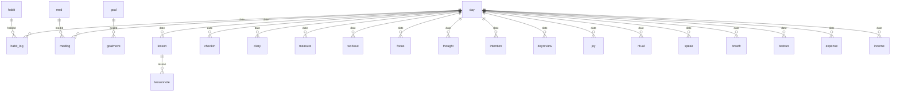

# Связи между данными (ER-диаграмма)

_Файл создан из `registry.js` (`RELATIONS` и `BY_DAY`) и сверяется с ним тестом: правь реестр, а не этот файл._

Записи не хранят вложенных копий друг друга: связь идёт по идентификатору или по дате. Диаграмма в формате Mermaid (отображается на GitHub).

## Связи по идентификатору

| Родитель | Потомок | Поле | Смысл |
|---|---|---|---|
| `habit` | `habit_log` | `habitId` | отметки привычки по дням |
| `med` | `medlog` | `medId` | приёмы лекарства |
| `goal` | `goalmove` | `goalId` | взносы в копилку |
| `lesson` | `lessonnote` | `lesson` | конспект к пройденному уроку |

## Записи по дням

Эти типы привязаны к дню полем `date`: `checkin`, `diary`, `measure`, `workout`, `focus`, `thought`, `intention`, `dayreview`, `joy`, `ritual`, `speak`, `breath`, `testrun`, `expense`, `income`, `medlog`, `habit_log`, `lesson`. Узел «day» условный: отдельной записи «день» нет, день — это просто дата.

## Внутри записи (не отдельные типы)

- `okr` содержит список результатов `krs[]` (текст, цель, текущее значение, единица).
- `workout` содержит упражнения и подходы `exercises[].sets[]`.
- `testrun` содержит результаты тестов и отдельные пробы `tests{}.trials[]`.
- `decision` содержит итог `closed{}` после оценки решения.

