# Диаграммы состояний

Как живут основные записи приложения. Диаграммы описывают то, что реально делает код (файл указан у каждой), и проверяются тестом: если убрать диаграмму или файл, тест `tests/r39.test.mjs` упадёт. Просмотр в GitHub и в редакторах с поддержкой Mermaid.

Общее правило: записи только добавляются и заменяются целиком (по `id`). «Состояние» — это значение поля внутри записи, а не отдельная таблица.

## Задача (`events.js`)

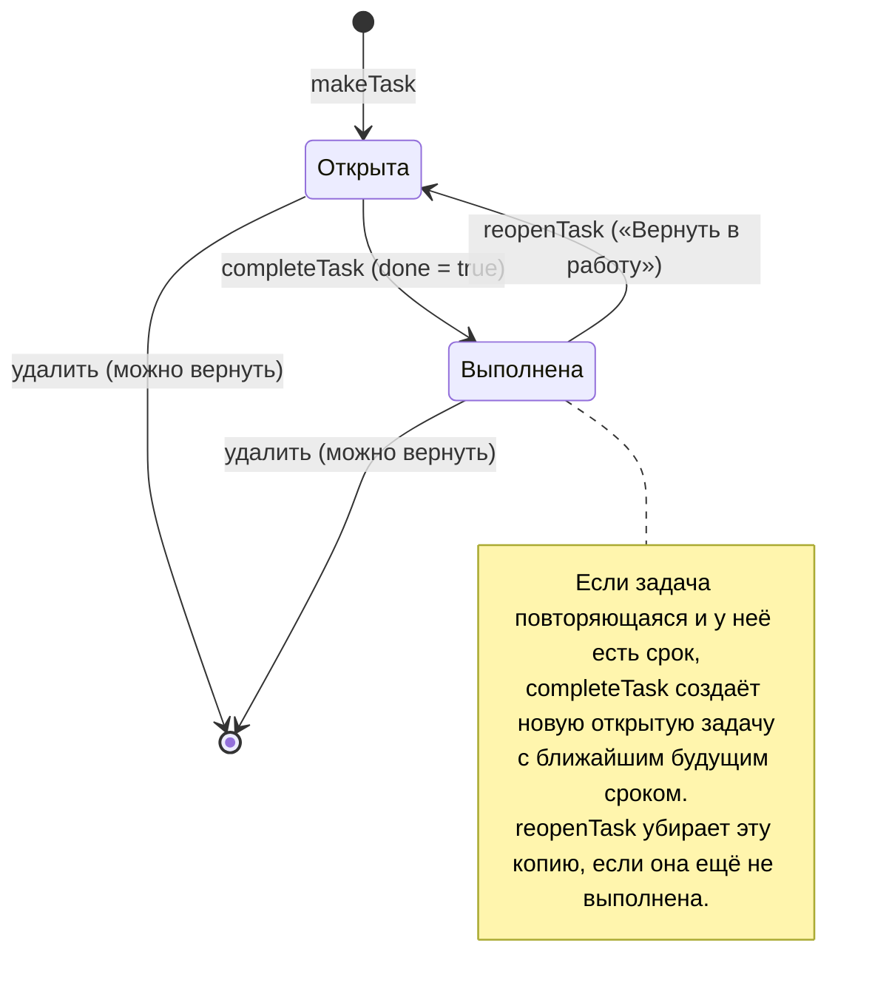

Просрочена — не состояние, а вычисляемый признак: открыта и срок раньше сегодняшнего дня. Выполненное повторяющееся не плодит хвост из прошлого: следующий срок всегда в будущем.

## Привычка и отметка дня (`habits.js`, `sick.js`)

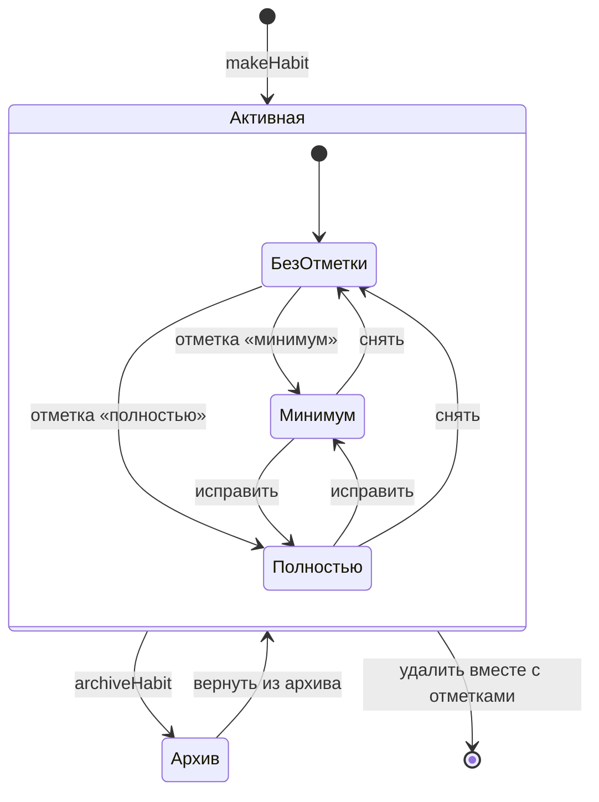

Серия идёт по дням с отметкой любого уровня. Вчерашний пропуск включает подсказку «не пропускай второй раз», перерыв от трёх дней — подсказку вернуться с минимума. В дни режима болезни пропуски не считаются срывом, а серии не сгорают.

## Режим болезни (`sick.js`)

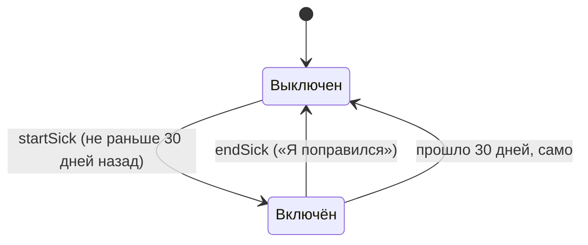

Повторно включить уже включённый режим нельзя. Пока режим включён, привычки на паузе, проверки и напоминания о привычках отложены, а такие дни исключаются из поиска связей.

## Карточка для повторения (`srs.js`)

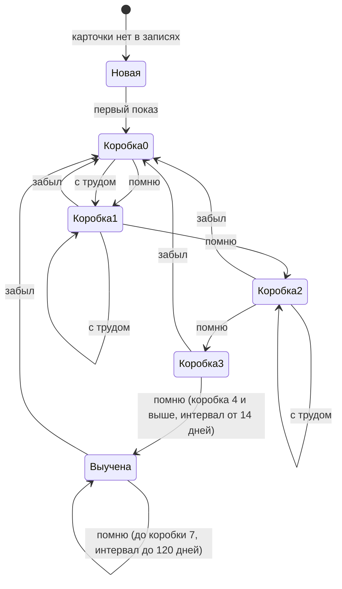

Интервалы по коробкам: 0, 1, 3, 7, 14, 30, 60, 120 дней. «Забыл» возвращает в коробку 0 и считает срыв (`lapses`). «Помню с трудом» оставляет коробку (но не ниже первой) и показывает карточку через половину её интервала. Карточка, которую забыли три раза и которая ещё не выучена, попадает в «трудные» (`leeches`).

## Решение в дневнике решений (`reflect.js`)

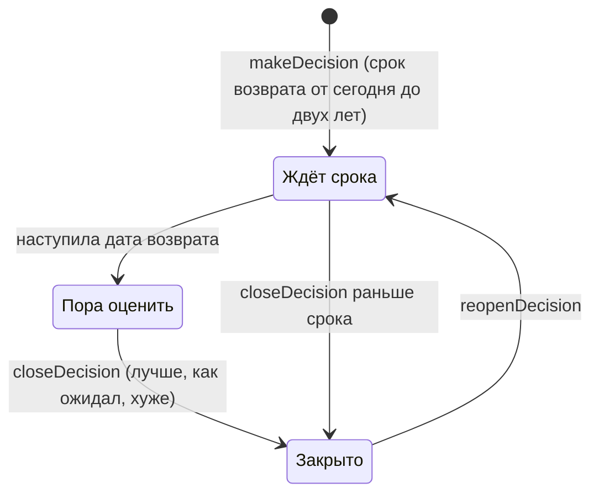

## Желание купить (`wishes.js`)

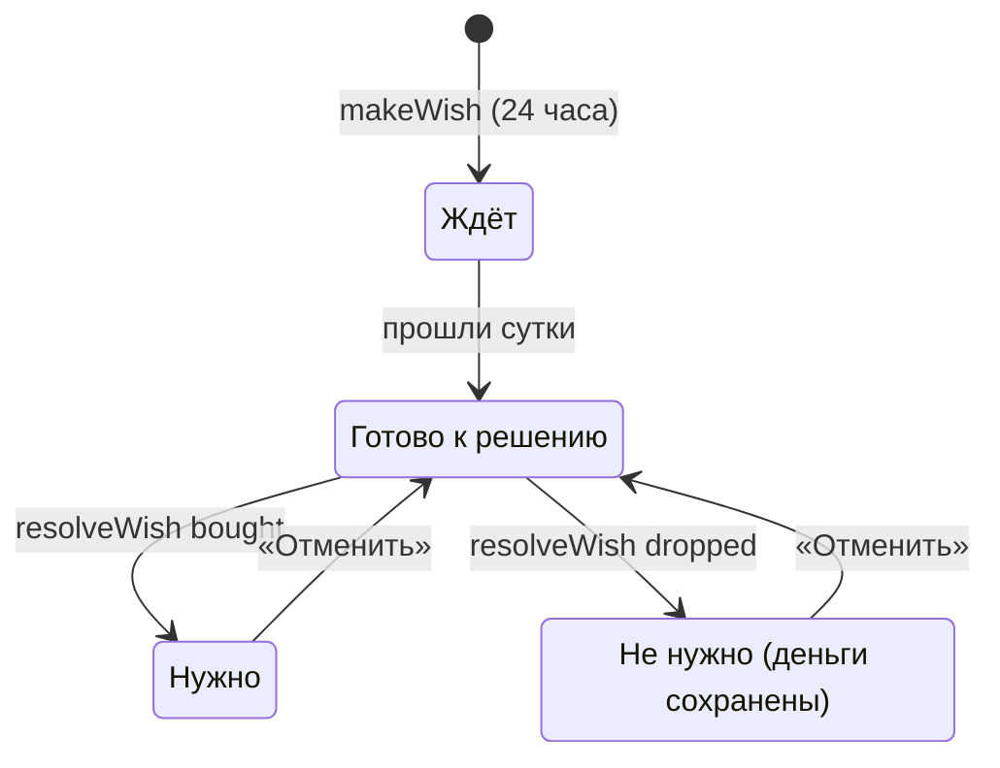

## Долг или заём (`debts.js`)

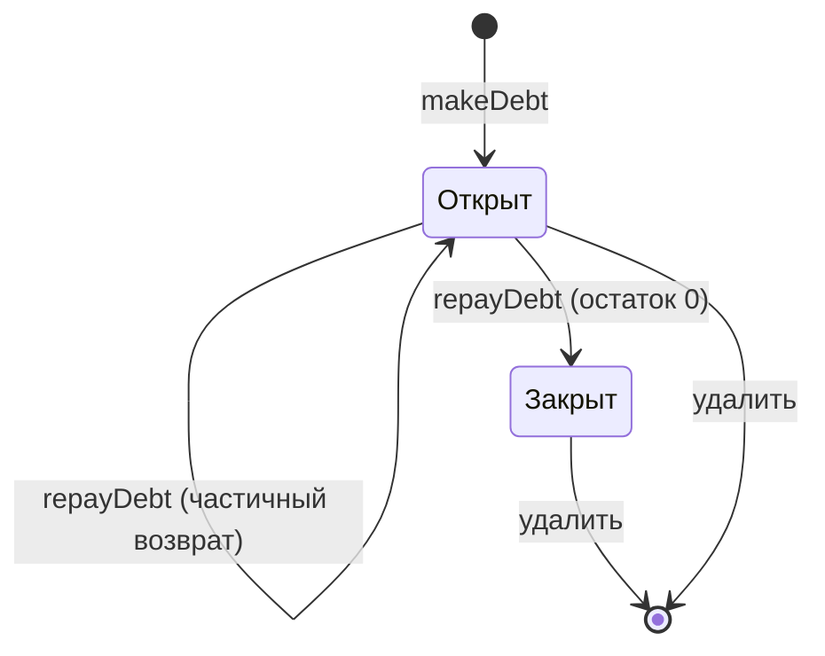

Просрочен — вычисляемый признак: открыт и срок раньше сегодняшнего дня. Возврат больше остатка не принимается.

## Отложенная мысль (`parked.js`)

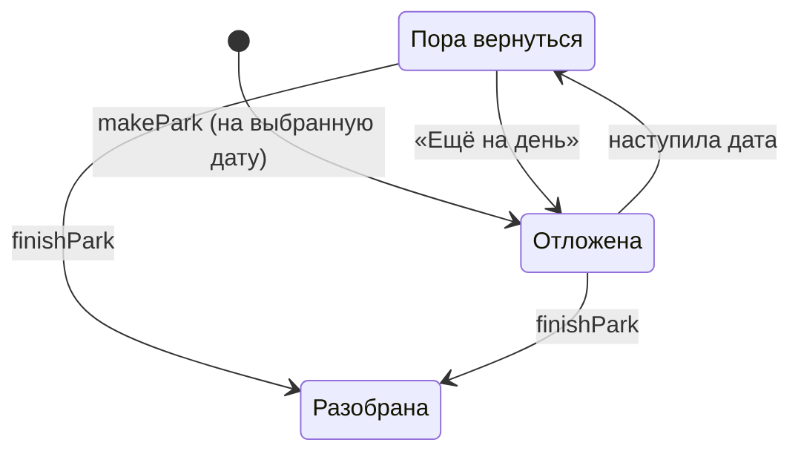

## Навык (`skills.js`)

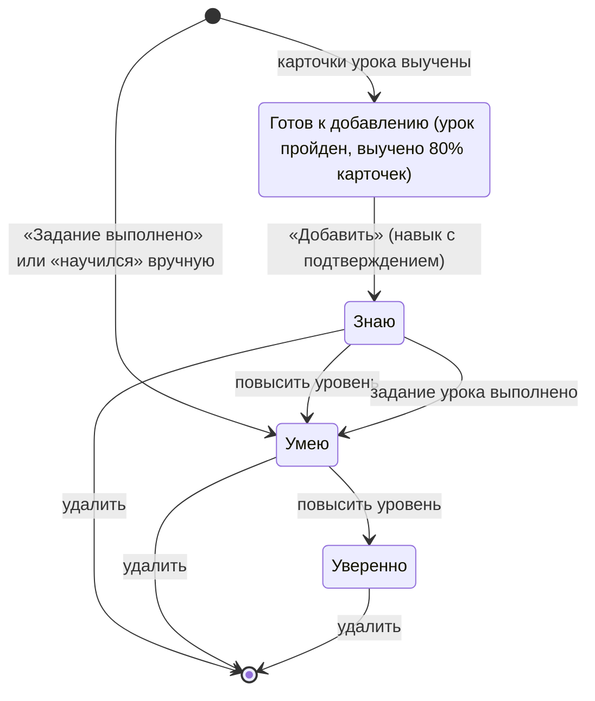

Навык из урока имеет постоянный номер (`skill:lesson:<урок>`), поэтому повторное добавление не создаёт дубль. Если карточки потом забываются, навык не исчезает: он подтверждает, что когда-то было освоено.

## Загрузка архива (`archive.js`)

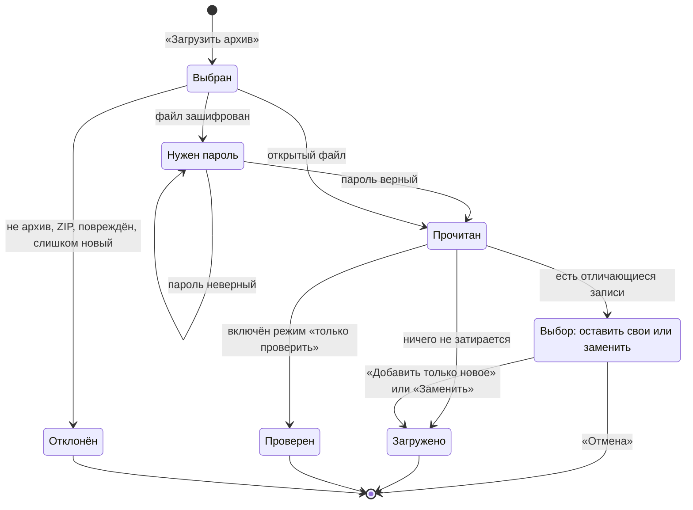

## Вход в приложение (`app.js`, `view-account.js`)

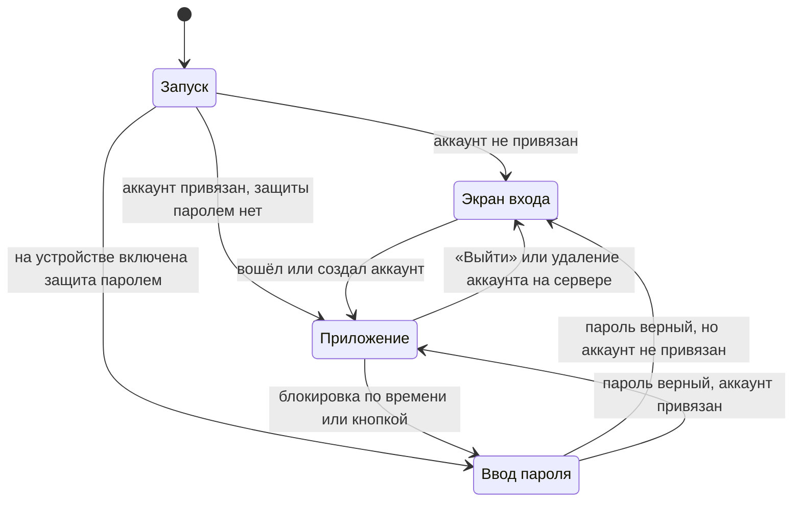

Без привязанного аккаунта приложение не открывается, но данные на устройстве не трогаются: при входе они остаются или (если ключ другой) сначала сохраняется зашифрованная копия. Вход проверяется на устройстве, поэтому уже привязанное устройство открывается и без сети.

## Обновление приложения (`updater.js`, `view-update.js`)

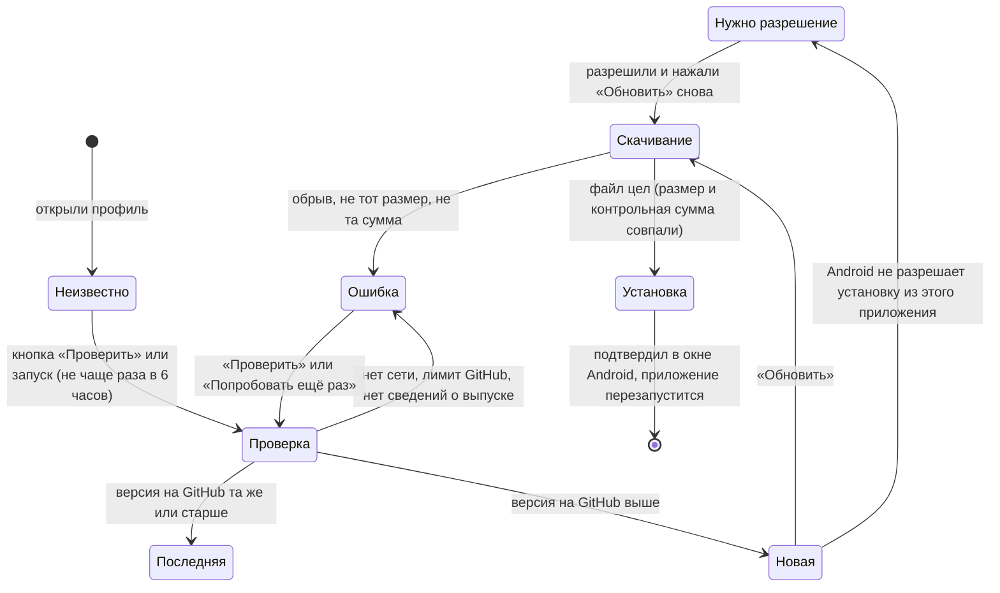

На сайте вместо загрузки файла страница перезагружается с новыми файлами. Скачивание идёт только с GitHub и только по https; установленное приложение обновляется только файлом, подписанным тем же ключом.

